# JP-TV

<p align="center">
  <strong>A custom Android TV / Google TV launcher</strong><br/>
  Twelve themes that reshape the whole home · live wallpapers · D-pad first · built for a 2&nbsp;GB box
</p>

<p align="center">
  <a href="https://github.com/josephprada/JP-TV/actions/workflows/android.yml"></a>
  
  
  
</p>

JP-TV replaces the stock home screen with something you actually want to look at: glass UI, generative wallpapers (or your own video/image loops), a left app rail, network status at a glance, quick tiles into native Android settings, and a **theme engine** where each theme changes layout and motion — not just colors.

UI copy on the TV is **Spanish**. Code, identifiers and this README are English.

<p align="center">
  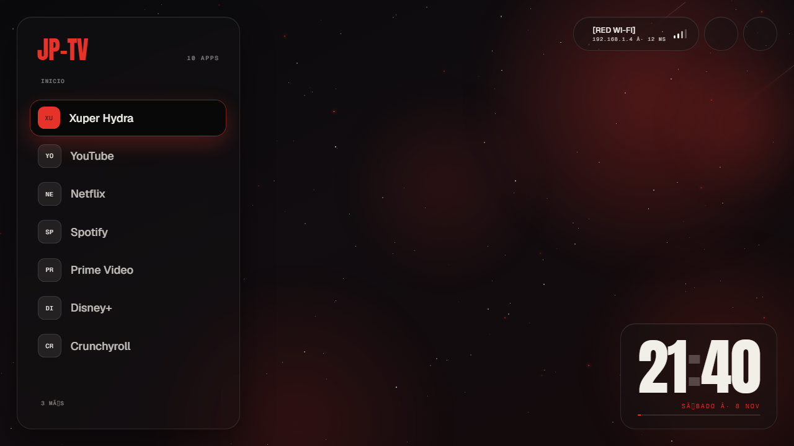
</p>

| | |
| --- | --- |
| **Primary device** | Amlogic box “V_BOX14” — Android 9 / API 28, 2 GB RAM, 1280×720 @ ~213 dpi |
| **Also targeted** | Generic Google TV projector (see [docs/phase-8-projector.md](docs/phase-8-projector.md)) |
| **Plan** | [PLAN.md](PLAN.md) — why and roadmap |
| **Agent map** | [CLAUDE.md](CLAUDE.md) — how to change things safely |
| **Design** | [`design/`](design/) — approved `.dc.html` artboards |

---

## Screenshots

Renders of the approved artboards in [`design/project/`](design/project/) (same boards the TV themes target). Full set under [`docs/screenshots/`](docs/screenshots/).

### Themes

| JP-TV | Pixel | Terminal |
| :---: | :---: | :---: |
|  | 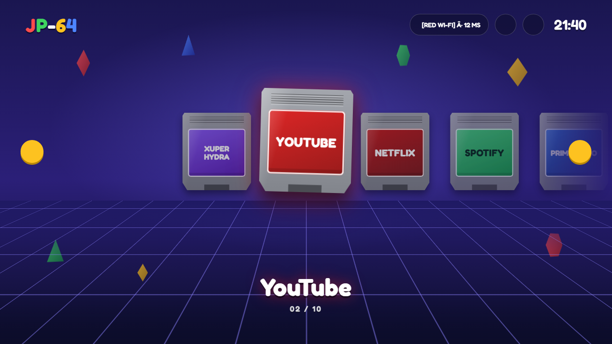 | 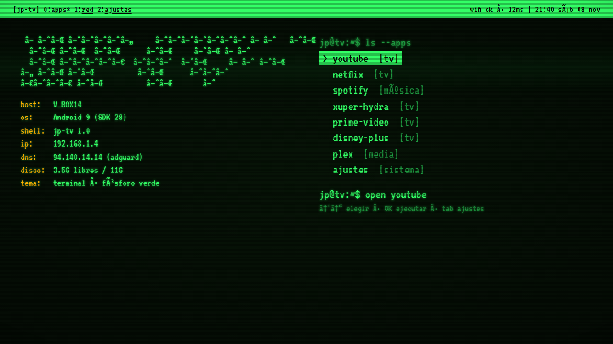 |
| **JP-TV** | **Pixel** | **Terminal** |

| Cartelera | Zen | HUD |
| :---: | :---: | :---: |
| 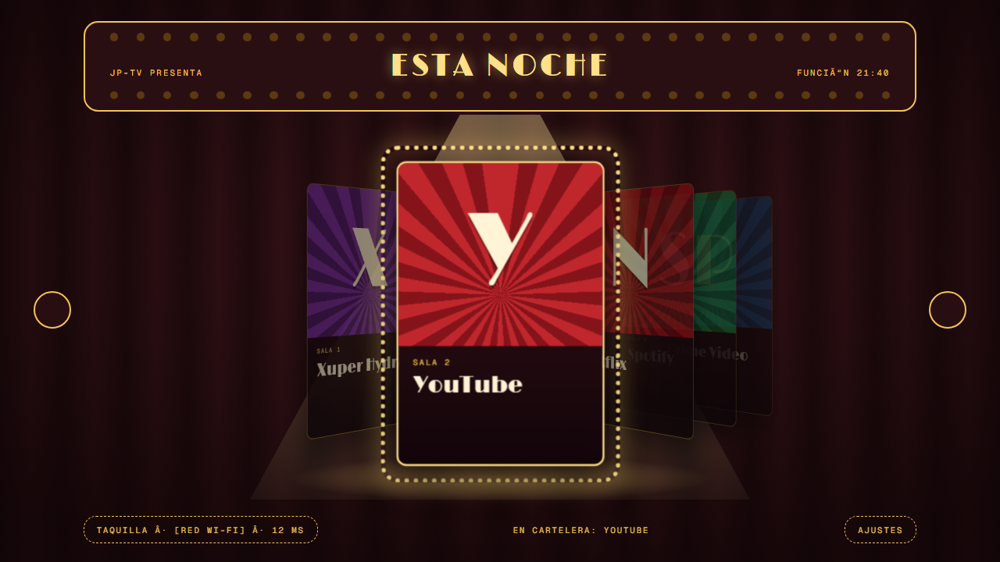 | 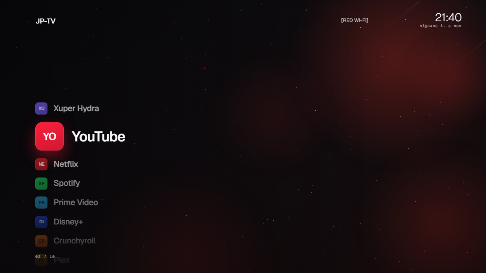 | 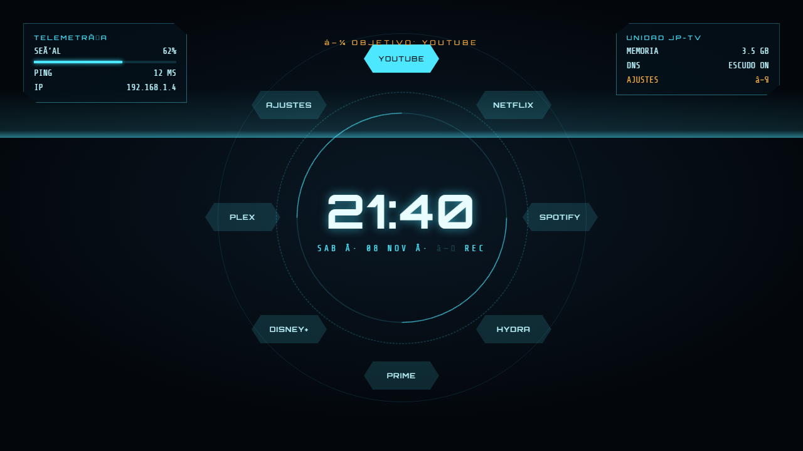 |
| **Cartelera** | **Zen** | **HUD** |

| Vinilo | Lo-fi | Gotham |
| :---: | :---: | :---: |
| 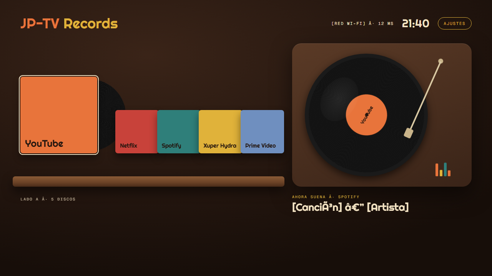 | 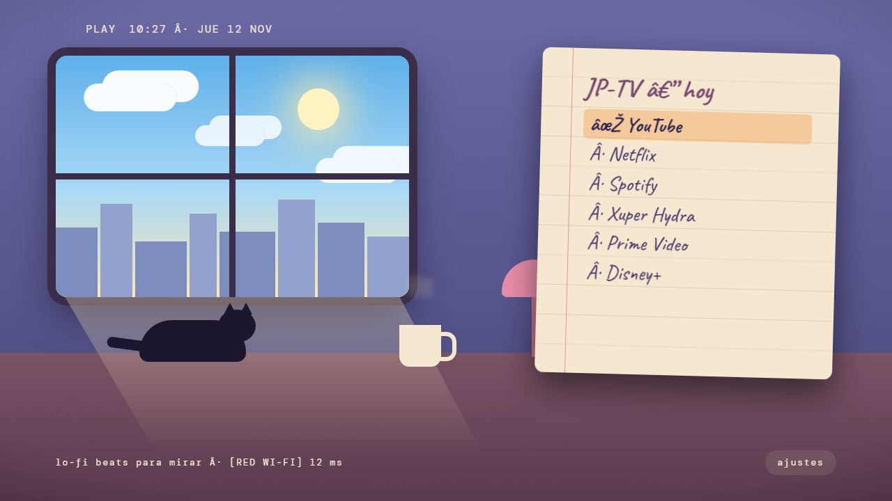 | 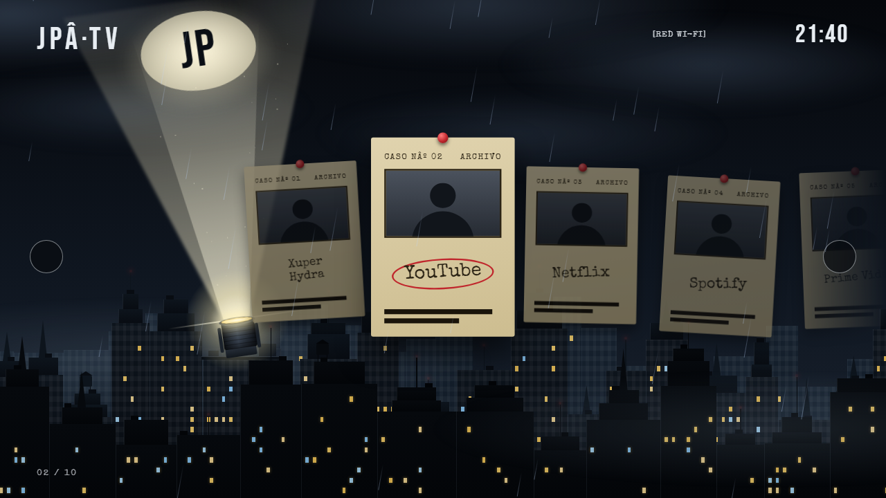 |
| **Vinilo** | **Lo-fi** | **Gotham** |

| Multiverso | Cyberpunk | Océano |
| :---: | :---: | :---: |
| 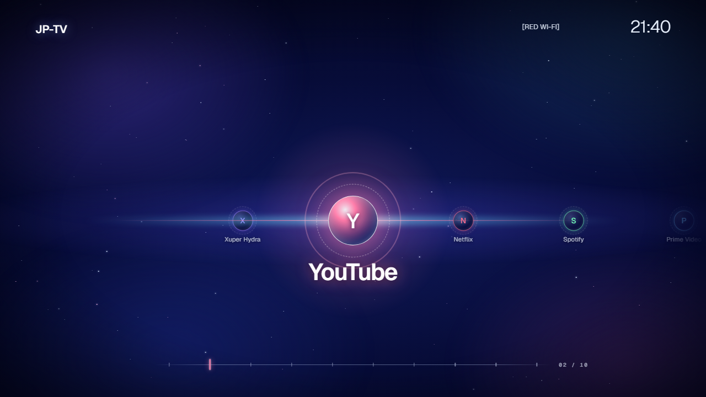 | 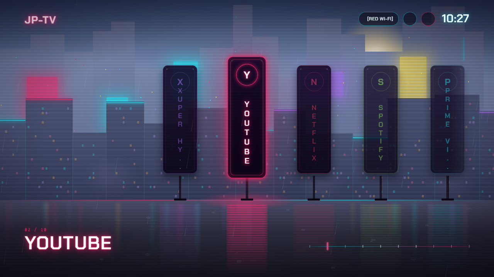 | 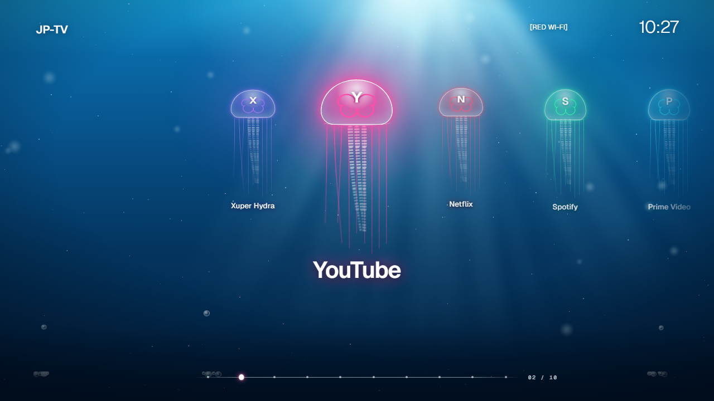 |
| **Multiverso** | **Cyberpunk** | **Océano** |

### Panels

| Themes picker | Customize | Network | Settings |
| :---: | :---: | :---: | :---: |
| 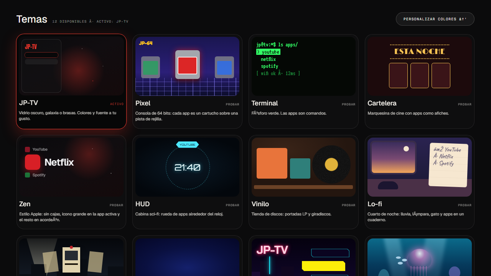 | 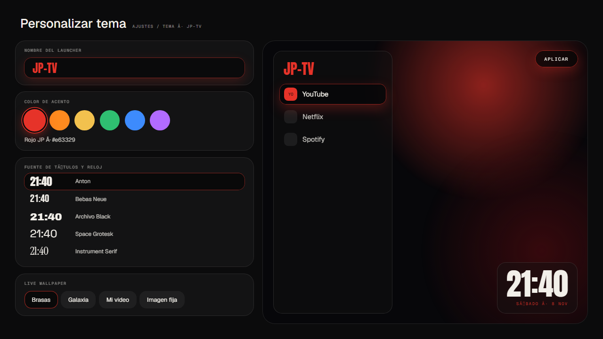 | 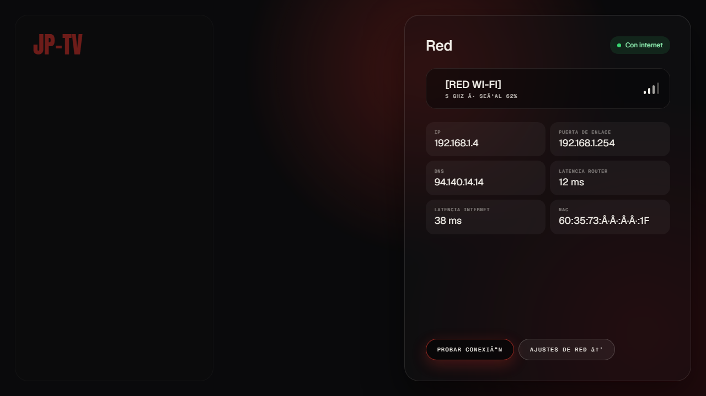 | 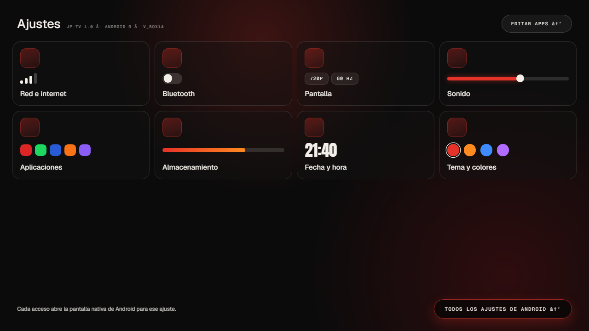 |

---

## What you get

| Area | Details |
| --- | --- |
| **Home as launcher** | Declared as `HOME` + `LEANBACK_LAUNCHER`. Set preferred with `adb` / `make deploy`. |
| **12 themes** | Each one is a full home layout (rail, carousel, wheel, noir wall, reef…). |
| **Live wallpapers** | Galaxy, Embers (“Brasas”), video playlist, still-image playlist. |
| **Apps** | Leanback + launcher apps, banners with icon fallback, reorder / hide, persisted. |
| **Network** | Live Wi-Fi / Ethernet chip + panel (IP, gateway, DNS, latency probe). |
| **Quick settings** | Tiles that open native Android settings with safe fallbacks. |
| **Customize** | Brand name, accent, title font, wallpaper, dim, clock 12/24h, sounds, weather place. |
| **Screensaver** | Idle dream / ambient modes (theme ambient, wallpapers, playlists). |
| **UI sounds** | Short procedural clips per theme (move / select / back / control). |
| **Low-end mode** | Auto when RAM ≤ ~2 GB: fewer stars, 30 fps, lighter glow. |
| **Home override** | Opt-in path for firmwares that ignore preferred home (projector-safe; never disables stock launchers). |

---

## Themes

Every theme receives the same `HomeState` + `HomeActions` and draws its own screen. Adding one = a folder under `themes/` + one line in `ThemeRegistry`.

| Id | Name | Feel |
| --- | --- | --- |
| `jptv` | **JP-TV** | Dark glass, galaxy or embers; accent + font are yours. |
| `pixel` | **Pixel** | 64-bit console: apps as cartridges on a grid track. |
| `terminal` | **Terminal** | Green phosphor; apps read as commands. |
| `cartelera` | **Cartelera** | Cinema marquee; apps as posters. |
| `zen` | **Zen** | Apple-like calm: big active icon, accordion for the rest. |
| `hud` | **HUD** | Sci-fi cockpit; apps on a wheel around the clock. |
| `vinilo` | **Vinilo** | Record shop: LP covers and a turntable. |
| `lofi` | **Lo-fi** | Night room: rain, lamp, cat; apps in a notebook. |
| `gotham` | **Gotham** | Noir city in the rain; apps as case files on the wall. |
| `multiverso` | **Multiverso** | Timelines; each app is a nexus of light. |
| `cyberpunk` | **Cyberpunk** | Neon street in the rain; apps as glowing signs. |
| `oceano` | **Océano** | Undersea reef; apps as glowing jellyfish. |

---

## Wallpapers & media

| Id | What it is |
| --- | --- |
| `galaxy` | Generative starfield (Compose `Canvas`, precomputed particles). |
| `embers` | Warm particle “Brasas”. |
| `video` | Media3 ExoPlayer loop — playlist from `/sdcard/JPTV/` (+ USB `JPTV/`). |
| `image` | Still image playlist from the same media folders. |

Wallpaper pauses when an app is in front (configurable) or a full-screen panel is open. Dim overlays up to 80%.

---

## Stack

| Area | Choice |
| --- | --- |
| Language | Kotlin 2.x |
| UI | Jetpack Compose + `androidx.tv:tv-material` |
| SDK | min 24 · target 35 |
| Persistence | DataStore Preferences |
| DI | Manual `AppContainer` (no Hilt) |
| Async | Coroutines + Flow |
| Video | Media3 ExoPlayer (`SurfaceView`, muted, looped) |
| Build | Gradle Kotlin DSL + version catalog |
| Tests | JUnit 5, Turbine, coroutines-test; Roborazzi off-device shots |
| CI | GitHub Actions → test + debug APK artifact |

Fonts ship in the APK (OFL / Apache). Nothing is fetched from the network at runtime for the UI chrome.

---

## Architecture

Single `:app` module, **screaming architecture** by feature, **hexagonal** inside each feature:

```
app/src/main/java/co/jp/tv/
├── JpTvApp.kt / AppContainer.kt / MainActivity.kt
├── apps/          # catalog, order, hide, launch
├── network/       # status + latency
├── settings/      # quick tiles + device helpers
├── preferences/   # LauncherConfig + DataStore
├── wallpaper/     # galaxy, embers, video, image
├── playlist/      # media scan + rotation
├── screensaver/   # idle / DreamService
├── weather/       # place + display data for themes
├── homeoverride/  # opt-in preferred-home takeover
├── themes/        # ThemeRegistry + one folder per theme
├── home/          # HomeViewModel → HomeState / HomeActions
└── core/          # design tokens, sound, util
```

**Rule:** `ui → domain ← data`. Domain is pure Kotlin (JVM-tested). Themes never touch `PackageManager`, DataStore or `ConnectivityManager` — only `HomeState` / `HomeActions`.

```kotlin
interface LauncherTheme {
    val id: String
    val displayName: String
    val supportsAccent: Boolean
    @Composable fun Home(state: HomeState, actions: HomeActions)
}
```

---

## Quick start

**Requirements:** JDK 17, Android SDK / platform-tools, a TV or box reachable over ADB.

1. Clone and open the repo.
2. Create `local.properties` (never commit it):

```properties
sdk.dir=C:\\Users\\you\\AppData\\Local\\Android\\Sdk
tv.host=192.168.1.4
```

3. Deploy as home:

```bash
make deploy   # build → adb install -r → set-home-activity → KEYCODE_HOME
```

4. Optional cold-start polish after the first launch:

```bash
make aot      # speed-profile compile on device
```

CI also uploads `jp-tv-debug.apk` on every push / PR if you prefer sideloading the artifact.

---

## Make targets

| Command | Does |
| --- | --- |
| `make build` | `:app:assembleDebug` |
| `make test` | JVM unit tests |
| `make deploy` | build, install, set as HOME, press HOME |
| `make aot` | `cmd package compile -m speed-profile` |
| `make startup` | cold-start timeline (`JpStartup` + system drawn times) |
| `make shot` | screencap → `shots/<timestamp>.png` |
| `make logs` | logcat for the running package |
| `make screens` | off-device Roborazzi + design artboard PNGs (no TV) |

Verification loop on device: change → `make deploy` → `make shot` → compare with `design/`.

---

## Design & off-device screenshots

Approved visuals live under [`design/`](design/) (Claude Design canvas, `.dc.html` boards). Treat them as the spec for layout, size, color and motion.

Without a TV, `make screens` renders app screens and design boards into `screens/` (gitignored). Side-by-side compare helper: `tools/design-shots/compare.py`. Limits: no real video, live icons or hardware blur — confirm those on the box.

---

## Device notes (important)

- Prefer **setting** JP-TV as home (`set-home-activity`). **Never** `pm disable` a stock launcher — on at least one projector OEM that caused a reboot loop.
- Some firmwares ignore preferred home. JP-TV’s **home override** is opt-in (usage-stats / accessibility backends) and keeps stock launchers enabled as fallback. Details and projector property notes live in [CLAUDE.md](CLAUDE.md).
- Android 9 has no real `RenderEffect` blur; the glass look uses a designed fake-glass fallback. API 31+ is richer.
- JP-TV stores no accounts. Optional location may be needed for Wi-Fi SSID; storage for custom media.

---

## Status

Phases **0–7** are on the product path: launcher, look & feel, network + settings, edit apps, customize, twelve themes, low-end polish, sounds, screensaver / playlists, home-override tooling.

**Still open:** projector walkthrough checklist — [docs/phase-8-projector.md](docs/phase-8-projector.md).

---

## Contributing / working in the repo

- Conventional commits (`feat(themes): add oceano home`). No AI attribution lines.
- One public composable or class per file; file named after it.
- Domain rules with behavior → test-first (JUnit 5 + Turbine).
- Colors / radii / motion from `core/design` tokens (theme-fixed palettes only in `<Theme>Palette.kt`).
- Infinite animations stop when `paused == true`.

Recipes for “add a theme / wallpaper / settings tile / UI sound” are in [CLAUDE.md](CLAUDE.md).

---

## License

Personal project by **Joseph Prada**. Bundled fonts are under the SIL Open Font License or Apache 2.0 (see `app/src/main/assets/licenses/`).
